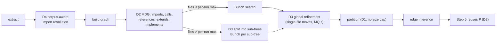

## Context

The four defects of the proposal were found by running the merged Bunch stage
on real repositories and patching around each one outside Graphos. The
workarounds were then validated at scale:

- 57 `dataset-discovery` repositories (C4 records, `check_c4.py` gate green);
- solario-core `14d86be28`;
- five Solario builds, 207–3,929 files.

This design moves each workaround into Graphos, keeping its measured behaviour.



## Decisions

### D1 — Exempt Bunch from the community-size cap

The cap (`capCommunitySizes`, `--max-community-fraction`, default 0.05) exists
because Leiden on 100k-node graphs could snowball one community. Bunch
optimises MQ, whose cluster factor `CF = 2µ / (2µ + ε)` already falls when a
module absorbs loosely coupled files. On a 29-file graph a 5 % cap allows at
most one file per module, which is MQ 0 by construction.

Alternative rejected: a size floor below which the cap is skipped. It keeps a
Leiden heuristic on an algorithm that does not need it, and still distorts
mid-size graphs (solario-core `src/cli`, 159 files, cap 7, had its largest
module cut at exactly 7).

### D2 — Relation allowlist and Step-5 reuse

`foldToFileMDG` folds every relation except `contains`, so the file graph
includes:

- `documents` doc↔code links: markdown files become MDG nodes;
- `inferred` / `depends_on`, which inference *derives from the Step-4
  partition*.

A module dependency graph in Mitchell & Mancoridis is the code's dependency
relation. The allowlist is `clustering.bunch.relations`, default
`[imports, calls, references, extends, implements]`, overridable for
experiments.

Because inference adds only non-allowlisted relations, the Step-5 MDG equals
the Step-4 MDG. The re-cluster is therefore a deterministic repeat. It is
skipped, and the Step-4 partition is joined to the enriched graph; the
`pipeline-clustering` requirement is modified for Bunch only. This also halves
Bunch's wall time.

### D3 — Partitioned search with global refinement

Measured cost of one search (η = 0, no annealing): 1 s at 164 files, 23 s at
441, > 28 min at 1,778. Building blocks are generated over every MDG edge, so
cost grows faster than linearly with edges.

- **Split.** A recursive directory split: a group above the per-run maximum
  splits by the next path component; sibling groups under 10 % of the maximum
  are pooled; a group with a single directory key is cut alphabetically.
  Sub-trees are processed in ascending path order; each gets the configured
  population and seed (search seeds `s..s+p−1`, as today).
- **Merge.** Module ids are offset per sub-tree in that order, so the merged
  partition is a deterministic function of (MDG, config).
- **Refinement.** Next-ascent over files in ascending path order. For file `f`
  in module `A`, the move to a neighbouring module `B` is evaluated with the
  incremental update:

  ```
  µA' = µA − kA      εA' = εA − (deg − kA) + kA
  µB' = µB + kB      εB' = εB − kB + (deg − kB)
  ```

  Here `kX` is the number of `f`'s pairs into `X` and `deg` is `f`'s pair count.
  The best move with gain > 1e-12 is applied. Passes repeat until a pass makes
  no move (cap 50 passes). MQ is strictly increasing over applied moves, so the
  pass terminates.
- **Cost.** One pass is `O(Σ deg)`. On pc26 (3,929 files, 17,292 pairs) it took
  7 passes and 2,225 moves, in seconds of Python. The Haskell version reuses
  `Bunch.hs`'s unboxed adjacency.
- **Leiden fallback.** `--bunch-max-files` stays a hard ceiling, default raised
  from 5,000 to 50,000, above which the stage logs the skip and runs Leiden as
  today.

### D4 — Corpus-aware import resolution

`resolveImport` runs per file, without the corpus. Resolution therefore
belongs after extraction, where the full set of extracted file paths is known.

| Target as extracted | Resolution |
|---|---|
| `src/a/foo` (relative, no extension) | `src/a/foo.<ext>` for the source language's extensions, then `src/a/foo/index.<ext>` |
| `external:@/x`, `~/x`, `#/x`, `$lib/x` | strip the alias root, then unique path-suffix match |
| `external:app/config` with tsconfig `paths` `app/*` → `src/main/webapp/app/*` | apply `paths` when a `tsconfig.json`/`jsconfig.json` is in the corpus; otherwise unique path-suffix match |
| `external:io.spring.core.Article` (JVM) | dots → `/`, unique suffix match on `.java/.kt/.scala`; a trailing member or `*` is dropped |
| anything matching zero or several files | unchanged |

Scoped npm packages (`@scope/pkg`), `node:` builtins and bare package names
whose first segment matches no corpus directory stay external. The rewritten
edge keeps its `EdgeId`; the dangling `External` node is dropped when nothing
references it any more.

## Risks

- **Output change.** More resolved imports change both Bunch and Leiden
  results; recorded baselines move.
- **False-positive suffix matches** (two `utils.ts` files): mitigated by the
  uniqueness rule. On `dataset-discovery` the check-labels-style gate (every
  path tracked, one component per file) stayed green across 57 repositories.
- **Cross-sub-tree structure.** At pc26 scale only 28 % of imports fall inside
  one sub-tree. Refinement recovers singletons and raises MQ (149 → 376), but
  modularity stays lower (0.156) than on graphs clustered in one run. The
  report states the split so that is visible.

## Validation targets (reproduce the workaround numbers)

| Graph | Expected after this change |
|---|---|
| nestjs-realworld (29 files) | 9 modules, MQ 4.20 (today 29 singletons, MQ 0) |
| solario-core `src/cli` (159) | MQ 18.37, 0 singletons |
| pc26 (3,929) | ≤ 1 % singletons, MQ ≥ 370 |
| taxonomy (Next.js `@/` aliases) | ≥ 100 files in the import graph (today 0) |
| jhipster frontend (`app/*` paths) | +224 resolved internal imports |
