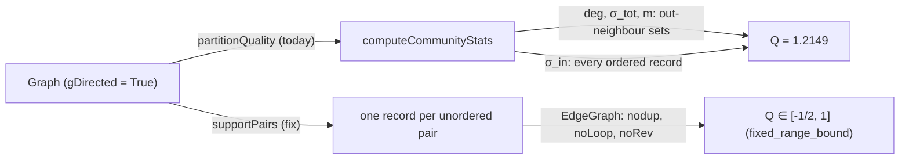

## Context

`modularity` is the auditable `Q` of AVI-618. Phase 1 of the Lean companion
proves its invariants (INV-Q0 to INV-Q5) over a *simple undirected support
graph* `G_s`. The Seam (`Seam/SupportGraph.lean`) pins `G_s` as the symmetric
closure of the valid endpoint pairs, read through `neighbors`. Two things fall
outside that pinning:

- `neighbors` is forward-only when `gDirected g` (`Seam`:
  `neighbors_of_directed`). The Seam therefore assumes the undirected flag.
  `detectCommunitiesWithResolution` honours it via `undirectedView`, but
  `partitionQuality` does not.
- `computeCommunityStats` takes `σ_in` from `Map.elems (gEdges g)`, which are
  ordered-pair records, rather than from the support relation. `RangeBound`
  models `σ_in` on an edge list with `edges_noRev`, which the record list does
  not satisfy.



## Goals / Non-goals

Goals: the report's `modularity` is the Phase 1 `Q` of the clustered
partition, provably in `[-1/2, 1]`, with Leiden partitions unchanged.

Non-goals: directed or weighted modularity in the report, and the cohesion
range defect (separate change).

## Decisions

### D1 — Project inside `modularity`, not at the call site

`modularity` SHALL build its statistics from `supportPairs g`, ignoring
`gDirected`. Patching only `partitionQuality` to
`modularity (undirectedView g) cm` would fix defect 1 alone, and would leave
the next caller free to repeat the mistake. `undirectedView` stays in use
where Leiden needs `neighbors` to answer both directions.

Alternative rejected: `undirectedView` at the call site only. It fixes the
solario-core number (0.6485 → 0.3367) but not orientation duplicates: Lean
`bothWays_legacy_undirected_exceeds_one` still gives `Q = 3/2`.

### D2 — One record per unordered pair

```haskell
supportPairs :: Graph -> [(NodeId, NodeId)]
supportPairs g = Set.toAscList $ Set.fromList
  [ (min s t, max s t)
  | e <- Map.elems (gEdges g)
  , let s = edgeSource e; t = edgeTarget e
  , s /= t, Map.member s (gNodes g), Map.member t (gNodes g) ]
```

From that list: `deg(v)` = number of pairs containing `v`, `m` = list length,
`σ_tot(c) = Σ_{v∈c} deg(v)`, and `σ_in(c) = 2 · #{pairs with both ends in c}`.
These are exactly `EdgeGraph.sigmaTot`, `sigmaIn` and `m` in `RangeBound.lean`.
Folding over `Set.toAscList` keeps the order deterministic (INV-Q4).

The canonical orientation is `(min, max)`. The Lean `supportPairs` keeps the
last orientation it meets instead. Every `EdgeGraph` aggregate is symmetric in
the endpoints, so `Qnum` does not depend on that choice. The cross-check rows
pin it on data.

Cost: `O(E log E)` for the set, the same order as the `Map` fold it replaces.

### D3 — Nodes outside the partition

`computeCommunityStats` maps nodes missing from the `CommunityMap` to community
`0` (`findWithDefault 0`). The Lean theorem is stated for a genuine set
partition. `partitionQuality` scores `finalComm`, which covers every node after
the size-cap post-pass; a `ClusterSpec` property asserts that coverage, so the
theorem's hypothesis holds on the path that prints the number.

## Lean arm

`formalization/lean/GraphosFormalization/Seam/UndirectedScoring.lean`, in
namespace `GraphosFormalization.UndirectedScoring`.

| Theorem | Statement |
|---|---|
| `twoArcs_legacy_directed_exceeds_one` | arcs `0→1`, `2→3`, blocks `{0,1},{2,3}`, `--directed`: `legacyNum = 6 > twoM² = 4` (`Q = 3/2`) |
| `bothWays_legacy_undirected_exceeds_one` | both orientations of `{0,1}` and `{2,3}`, undirected: `legacyNum = 24 > 16` (`Q = 3/2`) |
| `RecordGraph.toEdgeGraph` | `gEdges` keys → Phase 1 `EdgeGraph` over `supportPairs`; `edges_nodup`, `edges_noLoop`, `edges_mem`, `edges_noRev` proved |
| `RecordGraph.fixed_range_bound` | `IsSetPartition π V → 1 ≤ m → -2m² ≤ fixedNum π ≤ 4m²`, i.e. `-1/2 ≤ Q ≤ 1` |
| `RecordGraph.fixedM_pos` | non-empty records give `m ≥ 1` |
| `supportPairs_eq_self` | no pair stored twice → `supportPairs rs = rs` (simple inputs unchanged) |
| `mem_or_rev_mem_supportPairs` | every record survives as itself or its reverse (support preserved) |
| `twoArcs_fixed`, `bothWays_fixed`, `bothWays_fixed_in_range` | the fixed score on both witnesses: `8 / 16 = 1/2` |

Axioms: `propext` and `Quot.sound` only. No `sorry`.

Not proved in Lean: that the Haskell `(min, max)` canonicalisation matches the
Lean orientation choice. That rests on endpoint symmetry and is pinned by the
cross-check rows.

## Risks

- Baselines quoting the old `modularity` change. Mitigation: grep `docs/` and
  `openspec/` for `modularity = ` and refresh them in the same PR.
- Large graphs: building the pair set costs `O(E log E)` once per report. It
  is not measured yet; task 3.1 records the cluster-stage time on solario-core
  (292,680 edges) next to the old one.
